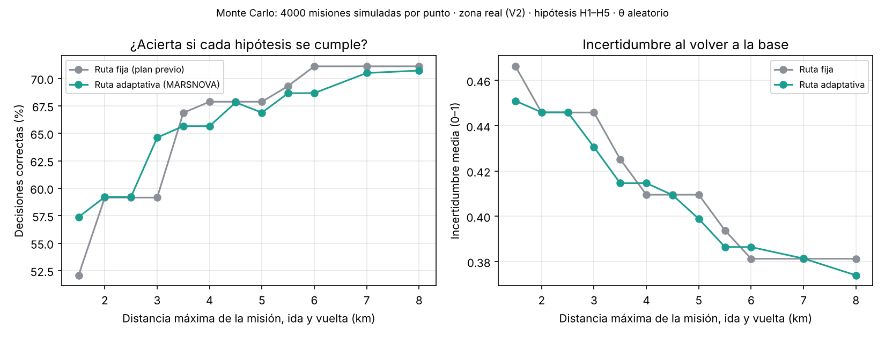

# MARSNOVA

> **A layered map that keeps the first astronauts on Mars safe, works without a link to Earth, and learns from every observation.**

**NASA Space Apps Challenge 2026 — Interplanetary Survival Guide: Martian Map**
Team MARSNOVA · Local event: Popayán, Colombia

 <!-- TODO: add a screenshot of the app -->

## What it does

MARSNOVA is a mobile app for an astronaut exploring the **boxwork formations of Mount Sharp (Gale Crater)**, the ridge networks Curiosity began studying in 2025. It combines in one layered map:

- **A route for someone in a spacesuit**: on a 10 m cost matrix derived from the HiRISE DTM, where slopes above 20° are blocked for routes computed with A*. The team's planned route crosses three 10 m cells at 21.7–25.2° on narrow ridge passes; the app flags them, because going around would add about 150 m (P01–P02) and 700 m (P02–P03) each way. The base sits at the midpoint of the route (P02), so the astronaut is never more than 1.65 km from shelter, within NASA's 2 km walking-EVA guideline for Artemis. The base site is gentle ground: within 30 m of P02, slope ≤ 8° and relative terrain cost ≤ 2 of 6.
- **Science that learns**: at each stop the astronaut answers *Yes / No / Inconclusive* for a hypothesis; a Beta-Binomial model updates the probability for all terrain of the same type and re-ranks the remaining stops by how much information they can still provide.
- **Conditions and alerts that do not depend on the network**: temperature, dust, light and wind (Mars Climate Database), radiation dose for the walk (Curiosity RAD), and solar-storm alerts (NASA DONKI) relayed from Earth and cached on the phone. Observations are stored locally and synchronized without duplicates when the link returns.

## How to run

```bash
cd app
npm install
cp ../.env.example .env        # add your free key from https://api.nasa.gov
npx expo start
```

Tests: `npm test` · Type check: `npm run typecheck`

## Data sources

| Source | Provider | Used for |
|---|---|---|
| HiRISE DTM `DTEEC_001488_1750_001752_1750_U02` and ortho image `PSP_001752_1750` | NASA / JPL / University of Arizona (MRO) | Terrain, slope, TPI, roughness, cost matrix, base map |
| MOLA MEGDR (128 px/°) | NASA (MGS) | Regional context, pressure correction for elevation |
| Mars Climate Database v6.2 | LMD / ESA / CNES | Temperature, pressure, wind, dust, sunlight, clouds; dust-storm scenarios |
| Curiosity RAD (`MSL_RAD_OBS-L2`, via CDAWeb) | NASA / SwRI (MSL) | Surface radiation dose; solar events of Sept 2024 and May 20, 2024 |
| DONKI (WSA-Enlil simulations) | NASA CCMC | Space-weather alerts at Mars |
<!-- TODO: add a row for Curiosity images once photos are added to the stops -->

Ranges, units and how each variable is used: [docs/condiciones_ambientales.md](docs/condiciones_ambientales.md).

## Does the adaptive route help? (Monte Carlo)

4,000 simulated missions per walking budget, using Julián's real cost matrix ([`montecarlo/`](montecarlo/), in TypeScript and replicated in MATLAB). Up to 2 km both strategies coincide; **from 4 km of walking, the adaptive route ends with less uncertainty than the fixed route in 90–100% of the missions (89.8% at 4.5 km) and identifies hypotheses correctly more often on average (66–71% vs 60–69%)**. Between 2.5 and 3.5 km it reduces uncertainty more but is not more accurate.



## Modeling assumptions

- All cells of the same terrain type share a hypothesis probability (local homogeneity, reasonable at 1–2 km for a sedimentary facies). A distance-weighted update, w(d) = exp(−d²/2L²) with L ≈ 300 m, is future work.
- Prior Beta(2, 1); *Yes* → α + 1, *No* → β + 1, *Inconclusive* and *Not applicable* → no change. The team's science protocol ([ciencia/](ciencia/)) uses a uniform Beta(1, 1) as a conservative review analysis; the app keeps a weak Beta(2, 1) so each field observation visibly updates the map.
- Results are reported as the estimated probability of a favorable result among conclusive observations, never as a proven hypothesis. Science stops: P01, P03 and candidate stations E1–E5 from the science protocol.
- Environmental conditions are not applied per pixel (the zone is inside one MCD grid cell and RAD measures at one point): they act as time constraints — when to go out, how long to stay, and whether to go out at all.
- The cost matrix is an ordinal heuristic (1–6), not a NASA standard.
- Walking limits follow NASA's Artemis EVA concept of operations (slopes up to 20°, up to 2 km from the lander, EVAs up to 8 h), adopted by analogy: NASA has no official walking limit for Mars yet. Spacesuit resources for the real route: [modelo/recursos_eva/](modelo/recursos_eva/). These are **estimated values**, not real suit specifications: walking speed (2.4–2.5 km/h) and oxygen use (≈ 87 g/h) are consistent with Apollo surface EVAs (NASA TN D-7883; Apollo Lunar Surface Journal), but the assumed 65 kg suit is lighter than NASA's recommended 104 kg maximum for a Mars suit (ICES-2026-127).

## Repository structure

```
app/          Mobile app (Expo / React Native, TypeScript): map, science, conditions, mission
clima/        Environmental data (MATLAB): Mars Climate Database, MOLA, Curiosity RAD
terreno/      Terrain (QGIS): HiRISE DTM products, cost matrix, route, stops
ciencia/      Science protocol: hypotheses, questions Q1–Q5, candidate stations
montecarlo/   Fixed vs adaptive route simulation
rutas/        Route V2 in lat/lon and comparison with JMARS
modelo/       Spacesuit resources model for the walk
docs/         Environmental conditions table, demo slides
```

## Reproducing the data

- Climate: [clima/README.md](clima/README.md) (order of the MATLAB scripts and where to download the raw MCD files).
- Terrain: [terreno/README.md](terreno/README.md) and `app/scripts/apply_sig.py`.
- Large raw files (MCD `.nc`, MOLA, HiRISE JP2) are not stored in git; the READMEs give the download sources.

## Use of Super Intelligence

<!-- TODO: team to review and complete -->
The team used **Claude (Anthropic)** as an assistant during the hackathon: to discuss and structure the proposal, to write and debug code (the MATLAB processing scripts, the DONKI and radiation services, parts of the app), to convert data between formats, and to draft documentation. Files developed with assistance carry a header comment saying so. The team chose the site and scientific objectives, defined the hypotheses, produced the GIS analysis, and validated the results against independent sources (for example, the corrected surface pressure from the MCD files matches the MCD web interface, and the radiation values come directly from RAD measurements). No AI-generated images are used.

## Team

| Name | Role |
|---|---|
| Laura Vanessa Rengifo Martínez (team lead) | App development, environmental data |
| Julián Andrés Cruz Sambony | GIS: terrain analysis, cost matrix, route |
| Anfer Santiago Ballesteros Peña | Environmental data, Bayesian model, Monte Carlo |
| Juan David Cifuentes Rivera | Scientific hypotheses, field questions Q1–Q5, evidence protocol and candidate stations |

## License

MIT — see [LICENSE](LICENSE).
